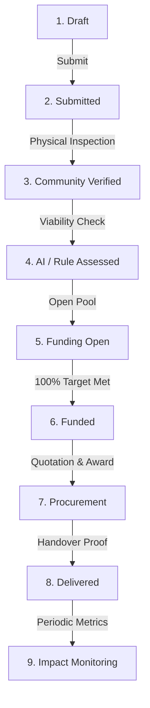

# JIBIKA (জীবিকা)
### Productive Asset Access & Livelihood Support Platform

[](tests)
[](https://laravel.com)
[](https://php.net)
[](LICENSE)
[](https://jibika.gadgetexa.com)

> **JIBIKA** connects underserved micro-entrepreneurs in Bangladesh (tailors, bakers, carpenters, smallholder farmers) with physical, income-generating productive assets through transparent community physical verification, deterministic explainable viability scoring, simulated asset sponsorship, competitive equipment procurement, and long-term livelihood impact tracking.

---

## 🌐 Live System & Demo Access

- **Public Live URL:** [https://jibika.gadgetexa.com](https://jibika.gadgetexa.com)
- **One-Click Demo Mode:** Available directly on `/login` and via the top-level **Judge Walkthrough Banner**.

### Seeded Demonstration Personas (Default Password: `password`)

| Role | Name | Email | Purpose in 9-Stage Lifecycle |
|---|---|---|---|
| **Worker** | Rahim Uddin | `worker@demo.local` | Request creator; owns delivered sewing machine with active monthly income logs. |
| **Community Verifier** | Master Anisur Rahman | `community@demo.local` | Local trade association leader; reviews and inspects pending requests on-ground. |
| **Asset Contributor** | Dr. Tariqul Islam | `contributor@demo.local` | Sponsors equipment units; views simulated funding pools and transparent allocations. |
| **Equipment Vendor** | Bengal Machinery Ltd | `vendor@demo.local` | Vetted industrial supplier; submits competitive quotes and handles physical delivery. |
| **System Administrator** | Lead Administrator | `admin@demo.local` | Approves funding pools, awards vendor tenders, reviews immutable audit trails. |

---

## 💡 The Core Problem: Breaking Microcredit Debt Traps

In developing economies like Bangladesh, informal micro-entrepreneurs frequently turn to high-interest microcredit loans to purchase productive equipment. However:
1. **Cash Diversion:** Unencumbered cash loans are frequently diverted to urgent household consumption, medical emergencies, or existing debt service rather than equipment.
2. **Compound Interest Traps:** High weekly repayment schedules begin immediately before the asset generates incremental revenue.
3. **Ghost Projects:** Without independent physical verification and post-handover monitoring, micro-grants suffer from high non-completion rates.

### The JIBIKA Solution: In-Kind Productive Financing
- **Zero Cash Handouts:** Financing is strictly routed to vetted equipment vendors who deliver physical machinery directly to the artisan.
- **Physical Handover Proof:** Deliveries require photographic evidence, serial verification, and signed worker receipt before vendor disbursement.
- **Post-Delivery Impact Tracking:** Periodic check-ins record real household net income and production volume over time.

---

## 🔄 The 9-Stage Asset Lifecycle



1. **`draft`**: Worker drafts need using natural language (Bangla or English) or speech input.
2. **`submitted`**: Worker reviews category, estimated cost, and livelihood justification, then submits.
3. **`verified`**: Community verifier inspects the artisan's workshop in person and records objective trade evidence.
4. **`ai_assessed`**: Platform computes an explainable viability score against market benchmarks and artisan experience.
5. **`funding_open`**: Approved request opens as a transparent sponsorship pool for individual or institutional contributors.
6. **`funded`**: 100% of the simulated target is reached; capital is locked for vendor procurement.
7. **`procurement`**: Registered suppliers submit competitive quotations; administrators select and contract the best bid.
8. **`delivered`**: Equipment is delivered on-site; photographic evidence and worker confirmation finalize handover.
9. **`monitoring`**: Household income, order volume, and equipment health metrics are tracked across post-handover intervals.

---

## 🤖 Responsible AI & Explainability Architecture

JIBIKA strictly enforces **honest technical provenance** across its intelligence layers:

### 1. Natural-Language Request Builder (`RequestDraftService`)
- Micro-entrepreneurs can express their equipment need in unstructured Bangla or English (or via Web Speech voice dictation).
- Uses Google Gemini Flash with schema-enforced JSON structured output.
- **Defensive Safeguards:**
  - Automatic PII redaction: Strips Bangladesh phone numbers (`01XXXXXXXXX`), NID numbers, and bank account sequences before model ingestion.
  - Strict catalog mapping: Only maps to existing, admin-approved asset categories.
  - Input clamping: Discards hallucinated or out-of-range figures (clamps strictly to BDT 1,000 – 5,000,000; defaults to category benchmark).
  - Deterministic Keyword Fallback: Transparently falls back to bilingual keyword matching if the AI provider is disabled, offline, or unconfigured.

### 2. Honest Rule-Based Assessment Engine (`AIService` `v1.1-rules`)
- JIBIKA does **not** masquerade deterministic heuristics as generative artificial intelligence.
- Evaluates four real objective inputs:
  - **Cost-to-Benchmark Ratio:** Compares requested amount against verified catalog market estimates (flags price anomalies >50%).
  - **Worker Experience:** Multi-year trade background increases viability score.
  - **Justification Depth:** Evaluates business rationale and uniform contract potential.
  - **Geographic Context:** Matches artisan location with trade clusters.
- **Audit Transparency:** Output metadata is explicitly stamped `is_ai_generated = false` and `provider_name = 'rule-engine'`.

---

## 🔒 Security & Data Integrity

- **Role-Based Access Control (RBAC):** Strict middleware guards (`active`, `admin`, role checks) prevent unauthorized role escalation, IDOR vulnerabilities, or cross-tenant data leakage.
- **Pessimistic Concurrency:** Database-level pessimistic locking (`lockForUpdate()`) ensures concurrent contributor pledges or assessment triggers never exceed funding caps or cause race conditions.
- **Immutable Audit Trail:** All administrative decisions, quotation selections, user suspensions, and state transitions are permanently recorded in an immutable audit table.
- **Simulated Crowdfunding Transparency:** To prevent regulatory ambiguity, all demonstration mode pledges are explicitly labeled as simulated, non-custodial commitments.
- **Safe Demo Controls:** Quick demo login is secured via HTTP POST, CSRF validation, and IP rate limiting (15 req/min).

---

## 🛠️ Tech Stack

- **Framework:** Laravel 12.x (PHP 8.2+)
- **Frontend:** Blade, Tailwind CSS, Vanilla JS, Web Speech API (`bn-BD`)
- **Localization:** Bilingual English (`en`) and Bengali (`bn`) with instant session-based locale switcher
- **Database:** SQLite (local development & automated tests), MariaDB / MySQL (production)
- **AI Integration:** Google Gemini API (`gemini-2.5-flash` / `gemini-1.5-flash`) with fallback keyword engine
- **Testing:** PHPUnit / Pest-compatible Laravel Feature & Unit test suite (79 tests, 409 assertions)

---

## 🚀 Local Development Setup

### Prerequisites
- PHP 8.2 or higher (with `pdo_sqlite`, `curl`, `mbstring`, `openssl`, `xml` extensions)
- Composer 2.x
- Git

### Installation Steps

1. **Clone the repository:**
   ```bash
   git clone https://github.com/sayeedalam/jibika.git
   cd jibika
   ```

2. **Install PHP dependencies:**
   ```bash
   composer install
   ```

3. **Configure Environment:**
   ```bash
   copy .env.example .env
   php artisan key:generate
   ```

4. **Initialize Database & Seed Data:**
   ```bash
   # Creates SQLite database and seeds catalog + demo personas
   php artisan migrate --seed
   ```

5. **(Optional) Configure Gemini AI Key:**
   To test real Gemini natural-language drafting in local development, add to your `.env`:
   ```env
   AI_PROVIDER=gemini
   AI_MODEL=gemini-2.5-flash
   AI_API_KEY=your_google_ai_studio_api_key_here
   ```
   *(If left blank, JIBIKA automatically and seamlessly runs using its bilingual keyword fallback engine).*

6. **Start the local server:**
   ```bash
   php artisan serve
   ```
   Open your browser at `http://localhost:8000`.

7. **Resetting Demo Data at Any Time:**
   ```bash
   php artisan demo:reset
   ```

---

## 🧪 Automated Testing

Run the full automated test suite:
```bash
php artisan test
```

Expected result:
```
Tests:    79 passed (409 assertions)
Duration: ~4.8s
```

The test suite covers:
- Complete 9-stage lifecycle transitions and state guards
- Rate-limited and whitelisted demo logins
- Deterministic rule engine scores, flags, and honest attribution
- Gemini request builder validation, catalog whitelisting, PII redaction, and fallback caching policies
- RBAC isolation, IDOR prevention, self-suspension blocks, and immutable audit logs
- Concurrent pledge handling and target boundaries
- Bilingual locale switching (`en` and `bn`) and walkthrough banner rendering

---

## 📂 Project Structure

```
app/
├── Actions/
│   ├── Assessments/        # Pessimistic-locked assessment execution
│   ├── Requests/           # Lifecycle state transitions
│   └── Verifications/      # Community evidence recording
├── Console/
│   └── Commands/
│       └── DemoResetCommand.php  # php artisan demo:reset
├── Http/
│   ├── Controllers/        # Role workspaces (Worker, Verifier, Contributor, Vendor, Admin)
│   ├── Middleware/         # Active status, EnsureAdmin, SetLocale
│   └── Requests/           # Form validation rules
├── Models/                 # AssetRequest, FundingPool, ProcurementOrder, AuditLog, etc.
└── Services/
    ├── AIService.php       # Deterministic v1.1-rules evaluation engine
    ├── GeminiClient.php    # Low-level structured HTTP client with timeouts
    └── RequestDraftService.php # Natural language parser & PII redactor
resources/
├── lang/ or lang/          # Bilingual translation dictionaries (en, bn.json)
└── views/
    ├── auth/               # Login with Quick Demo Personas
    ├── components/         # Status badges, Walkthrough banner, Provenance tags
    └── pages/              # Role dashboards, Request creation, Audit registry
```

---

## ⚖️ Pre-Event Disclosure & Hackathon Notice

- **Solo Participant:** Md. Sayeed Alam
- **Baseline Release:** `v0.9-pre-hackathon` (Tagged at baseline commit `0446857`).
- **YUNet 2026 Additions:**
  - Natural-language request drafting via Google Gemini Flash with schema enforcement and PII redaction.
  - Bangla voice-to-text integration via Web Speech API (`bn-BD`).
  - Transparent rule assessment engine (`v1.1-rules`) with strict honest provenance.
  - Role-based one-click demo mode with CSRF protection, rate limiting, and seeded narrative walkthroughs.
  - Bilingual localization switcher (`en` / `bn`).
  - Pessimistic concurrency locks, admin hardening, and `demo:reset` automation.

---

## 📄 License
This project is open-source software licensed under the [MIT License](LICENSE).
