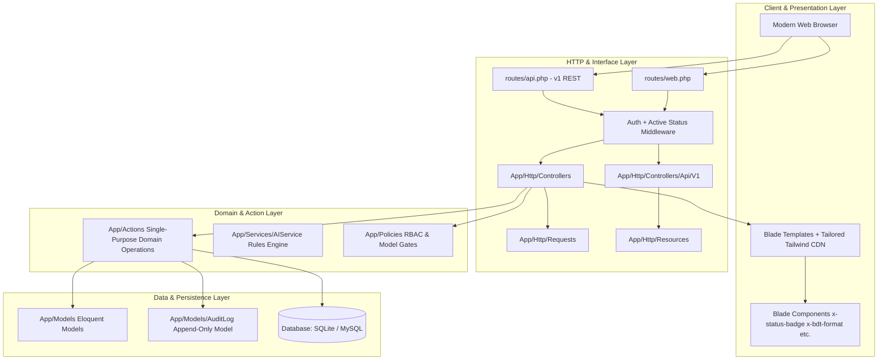

# JIBIKA — Architectural Overview

## 1. System Vision & Architecture Pattern

JIBIKA is a full-stack, modular livelihood support platform engineered using **Laravel 12 (PHP 8.2+)**, Blade, and Tailwind CSS. The system facilitates productive asset acquisition for micro-entrepreneurs and artisans through decentralized community verification, transparent rules-based scoring, simulated crowd-funding, competitive vendor procurement, and milestone-gated impact monitoring.

### Core Architectural Layers

---

## 2. Modules & Responsibilities

### 2.1 HTTP Coordination Layer (`app/Http/Controllers`)
Controllers strictly act as HTTP traffic coordinators:
- Authorize requests via Form Requests and Policies.
- Extract validated parameters.
- Delegate multi-entity business mutations to dedicated Action classes.
- Return appropriate view templates, flash redirects, or API Resource JSON envelopes.

### 2.2 Domain Action Layer (`app/Actions`)
Single-purpose business operations encapsulated in testable, reusable classes:
- **`App\Actions\AssetRequests\SubmitAssetRequestAction`**: Handles draft-to-submission, automated verifier queue assignment, notification, and audit trails.
- **`App\Actions\Assessments\AssessAssetRequestAction`**: Unified handler for transparent rule-based suitability scoring, ensuring deterministic evaluation and audit continuity.
- **`App\Actions\Verification\DecideVerificationAction`**: Orchestrates community verifier decisions, status mapping, and worker alerts.
- **`App\Actions\Funding\OpenFundingPoolAction`**: Administrative gate to activate crowd-funding pools.
- **`App\Actions\Funding\ContributePledgeAction`**: Pessimistic-lock protected pledge recorder preventing pool overfunding.
- **`App\Actions\Procurement\SubmitVendorQuotationAction`**: Supplier quote submission and provisional order generation.
- **`App\Actions\Procurement\SelectQuotationAction`**: Transactional, idempotent contract award that atomically rejects competitor quotes and cancels conflicting provisional orders.
- **`App\Actions\Procurement\RejectQuotationAction`**: Safe quotation rejection and obligation cancellation.
- **`App\Actions\Procurement\ConfirmDeliveryAction`**: Enforces physical delivery confirmation and dispute flags.
- **`App\Actions\Procurement\ResolveDeliveryDisputeAction`**: Administrative mediation workflow for delivery disputes.
- **`App\Actions\Monitoring\AddMonitoringRecordAction`**: Milestone logger gated strictly by verified delivery.

### 2.3 Transparent AI & Scoring Service (`app/Services/AIService.php`)
- Evaluates worker asset requests using transparent, explainable heuristic scoring.
- Configured strictly via `config('services.ai.*')`.
- Explicitly discloses provenance as a rule-based engine (`v1.0-rules`) with a mandatory `NOT AN LLM RESPONSE` disclosure in simulated/demo mode.

### 2.4 Presentation Layer (`resources/views`)
- Server-rendered Blade templates grouped by role workspace (`pages/dashboards/`) and functional domains (`pages/requests/`, `pages/procurement/`, etc.).
- Modular Blade components (`resources/views/components/`) for status badges, currency formatting, empty states, and simulation banners.
- No heavy client-side framework dependencies; lightweight CDN distribution compatible with standard cPanel hosting.

### 2.5 API Layer (`routes/api.php` & `app/Http/Resources`)
- Clean, versioned REST endpoints under `/api/v1/`.
- Standardized JSON serialization using Laravel API Resources.
- Strict cross-user isolation and role verification on all request resources.
