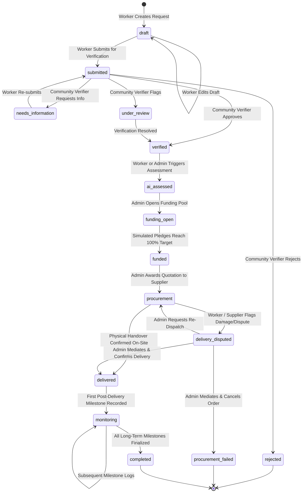

# JIBIKA — Asset Request Lifecycle & Business Invariants

## 1. 9-Stage Lifecycle State Machine

An asset request traverses 9 deterministic lifecycle states. State skips are strictly rejected by policies and actions.

---

## 2. Invariant & Transactional Rules

### Invariant 1: Draft-Only Modification
- **Rule:** A worker may edit parameters (`category_id`, `requested_amount_bdt`, `reason`, `livelihood_justification`) only when the request status is `draft`.
- **Enforcement:** Enforced in `AssetRequestPolicy::update()` and `UpdateAssetRequestRequest`. Once submitted, parameters are immutable.

### Invariant 2: Exclusive Contract Award & Concurrency Protection
- **Rule:** A funded asset request can only have **one** active winning quotation and **one** active procurement order. Submitting a quote does not imply contract award.
- **Enforcement:** 
  - `SelectQuotationAction` locks both the quotation and the asset request using `lockForUpdate()`.
  - Atomically marks the winning quote as `selected` and links its order to `asset_requests.procurement_order_id`.
  - Automatically identifies all competing pending quotations for that request, sets their status to `rejected`, and marks their provisional procurement orders as `failed`.
  - Subsequent selection requests are rejected as the request is no longer `funded` with `procurement_order_id === null`.

### Invariant 3: Pledging Boundaries & Concurrency Locking
- **Rule:** Cumulative pledges cannot exceed `target_amount_bdt`.
- **Enforcement:** `ContributePledgeAction` acquires a pessimistic lock (`lockForUpdate()`) on the `funding_pools` row, validates `$amount <= $remaining`, increments the balance, and atomically transitions the pool to `completed` and the request to `funded` when the goal is reached.

### Invariant 4: Post-Delivery Milestone Gate
- **Rule:** Monitoring records (income metrics, production output) cannot be logged before physical delivery of the equipment.
- **Enforcement:** `AddMonitoringRecordAction` rejects submissions unless `status` is in `['delivered', 'monitoring', 'completed']`. If the asset is in `procured` (in transit) or earlier, submissions are blocked. The milestone UI form is hidden in pre-delivery states.

### Invariant 5: Append-Only Audit Integrity & Redaction
- **Rule:** Audit entries are permanent and immutable. Sensitive credentials must never be written to disk.
- **Enforcement:**
  - `AuditLog::booted()` hooks throw `\RuntimeException` on `updating` or `deleting`.
  - `AuditLog::booted()` creates an automatic sanitizer that scrubs keys matching `password`, `token`, `secret`, `remember_token`, or `api_key` to `'[REDACTED]'`.
