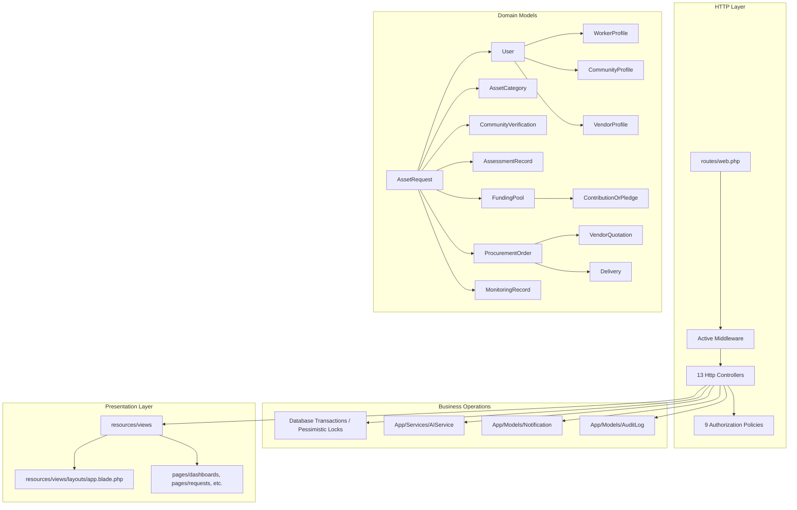
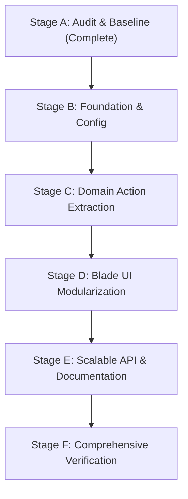

# JIBIKA — PHASE 5 ARCHITECTURE AUDIT & REFACTORING PLAN

**Project:** JIBIKA — Productive Asset Access & Livelihood Support Platform  
**Target Deployment:** IT Nut cPanel Hosting (`jibika.gadgetexa.com`, PHP 8.2/8.3, MariaDB/MySQL)  
**Baseline Commit:** `36b8821`  
**Audit Date:** October 25, 2026  
**Auditor:** Senior Laravel Architect, Security Engineer & QA Lead  
**Baseline Automated Test Suite:** **54 passed, 309 assertions, 0 failures** (Duration: 17.80s)  
**Static Blade Compilation:** 100% clean (`php artisan view:cache`)  

---

## 1. Executive Summary

JIBIKA is a functional, tested full-stack Laravel 12 application with 5 distinct role workspaces and a 9-stage asset lifecycle. While Phase 1–4 successfully established functional completeness, visual polish, and transactional invariants, the codebase has accumulated architectural debt typical of rapid feature evolution:
- Controller methods directly orchestrate multi-model transactions, audit logging, and notification dispatches.
- Request validation is duplicated across controller methods rather than encapsulated in dedicated Form Requests.
- The `AIService` directly consumes `env()` calls rather than relying on Laravel's configuration repository.
- Reusable UI elements (status badges, currency formatting, simulated-funding banners, empty states) are duplicated across Blade templates.
- Assessment triggering logic is duplicated between `AssetRequestController` and `AssessmentController`.

This refactoring plan outlines a safe, incremental migration that preserves all 54 passing tests, database schemas, and business invariants while introducing **Actions**, **Form Requests**, **Blade Components**, **Config abstraction**, and a modular **v1 API structure**.

---

## 2. Dependency Map

The application comprises 16 Eloquent models, 13 controllers, 9 policies, 1 middleware, 1 service, and 23 Blade views.

---

## 3. Detailed Audit Findings & Code Smells

### 3.1 Oversized Controllers with Embedded Domain Logic
| Controller Method | Current Responsibilities | Target Refactoring |
| :--- | :--- | :--- |
| `AdminController::selectQuotation` | Pessimistic locking on request and quotation, updating winner, updating request, querying competitors, rejecting competitors, failing competitor orders, logging winner audit, logging competitor audits, dispatching 3 notifications. | Extract to `App\Actions\Procurement\SelectQuotationAction` |
| `AdminController::rejectQuotation` | Updating quotation, failing unawarded provisional order, logging audit, creating vendor notification. | Extract to `App\Actions\Procurement\RejectQuotationAction` |
| `AssetRequestController::submit` | Verifying worker ownership & draft status, resolving active community verifier, creating `CommunityVerification`, dispatching notification, updating request status, writing audit log. | Extract to `App\Actions\AssetRequests\SubmitAssetRequestAction` |
| `AssetRequestController::assess` & `AssessmentController::trigger` | **Duplicate Code Smell**: Exact duplicate logic in two controllers! In addition, `AssessmentController::trigger` omitted the `AuditLog::create` entry that `AssetRequestController::assess` recorded. | Consolidate into single `App\Actions\Assessments\AssessAssetRequestAction` |
| `FundingController::openPool` | Admin authorization, status check (`ai_assessed`), checking existing pool, creating `FundingPool`, updating request status to `funding_open`, writing audit log, creating worker notification. | Extract to `App\Actions\Funding\OpenFundingPoolAction` |
| `FundingController::contribute` | Contributor role authorization, open status check, pessimistic locking (`lockForUpdate`), remaining balance calculation, balance increment, goal-completion check, request status update to `funded`, creating pledge, writing audit log, creating notification. | Extract to `App\Actions\Funding\ContributePledgeAction` |
| `ProcurementController::confirmDelivery` | Order status validation (`failed` check, `selected` quotation check, active order check), updating order status, upserting `Delivery`, updating request status (`delivered` or `delivery_disputed`), writing audit log. | Extract to `App\Actions\Procurement\ConfirmDeliveryAction` |
| `ProcurementController::resolveDispute` | Admin authorization, active dispute verification, multi-branch resolution (`confirm_delivered`, `mark_failed`, `reopen_procurement`), updating delivery, updating order, updating request, writing audit log, creating worker notification. | Extract to `App\Actions\Procurement\ResolveDeliveryDisputeAction` |
| `VendorController::quote` | Vendor authorization, funded check, duplicate quotation check, creating provisional `ProcurementOrder`, creating `VendorQuotation`, writing audit log, creating admin notification. | Extract to `App\Actions\Procurement\SubmitVendorQuotationAction` |
| `VerificationController::decide` | Verification state check, updating verification, mapping status to request status, updating request, dispatching worker notification, writing audit log. | Extract to `App\Actions\Verification\DecideVerificationAction` |
| `MonitoringController::store` | Role check, delivery state gate check, creating `MonitoringRecord`, updating request to `monitoring` if first milestone on `delivered` asset, writing audit log. | Extract to `App\Actions\Monitoring\AddMonitoringRecordAction` |

### 3.2 Duplicated Validation & Missing Form Requests
- `AssetRequestController::store` and `AssetRequestController::update` repeat identical validation arrays (`category_id`, `requested_amount_bdt`, `reason`, `livelihood_justification`).
- All other controllers (`FundingController`, `VendorController`, `ProcurementController`, `VerificationController`, `MonitoringController`, `ProfileController`) use inline `$request->validate()`.
- **Target:** Introduce dedicated Form Requests in `App\Http\Requests\` to separate HTTP parameter validation and authorization from controllers.

### 3.3 Configuration & Environment Smells
- `App\Services\AIService.php` directly executes `env('AI_PROVIDER')` and `env('AI_API_KEY')`.
- Running `php artisan config:cache` in production causes `env()` calls outside `config/` to return `null`.
- **Target:** Create `config/ai.php` (or add to `config/services.php`) and access exclusively via `config('services.ai.*')`.

### 3.4 Blade Template Duplication
- **Status Badges:** Repeated manual Tailwind markup across `resources/views/pages/requests/show.blade.php`, `index.blade.php`, and the 5 role dashboards.
- **BDT Currency Display:** Inconsistent combinations of `BDT [amount]`, `৳ [amount]`, and raw numbers.
- **Alerts & Disclaimers:** Repeated notices for simulated pledges and rule-based non-LLM disclosures.
- **Empty States:** Repeated empty table/card state markup.
- **Target:** Extract clean, reusable Blade components (`<x-status-badge>`, `<x-bdt-format>`, `<x-simulated-alert>`, `<x-empty-state>`).

### 3.5 API Layer Opportunity
- The application currently has no API endpoints defined (`routes/api.php` is absent).
- A clean, versioned read/inspection API (`/api/v1/requests`, `/api/v1/funding-pools`, `/api/v1/categories`) using Laravel API Resources will support future mobile clients and platform integrations while keeping the web application 100% stable.

---

## 4. Prioritized Refactoring Plan

### Stage B — Foundation & Configuration Cleanup
1. Move AI service configuration into `config/services.php`.
2. Refactor `AIService` to read strictly via `config('services.ai.*')`.
3. Create base Form Requests with consistent validation rules:
   - `StoreAssetRequestRequest` & `UpdateAssetRequestRequest`
   - `ContributePledgeRequest`
   - `SubmitVendorQuotationRequest`
   - `DecideVerificationRequest`
   - `ConfirmDeliveryRequest` & `ResolveDisputeRequest`
   - `StoreMonitoringRecordRequest`
   - `UpdateProfileRequest`

### Stage C — Domain Action Extraction
1. Extract business operations into single-responsibility Action classes:
   - `App\Actions\AssetRequests\SubmitAssetRequestAction`
   - `App\Actions\Assessments\AssessAssetRequestAction` (resolving duplication between `AssetRequestController` and `AssessmentController`)
   - `App\Actions\Verification\DecideVerificationAction`
   - `App\Actions\Funding\OpenFundingPoolAction`
   - `App\Actions\Funding\ContributePledgeAction`
   - `App\Actions\Procurement\SubmitVendorQuotationAction`
   - `App\Actions\Procurement\SelectQuotationAction`
   - `App\Actions\Procurement\RejectQuotationAction`
   - `App\Actions\Procurement\ConfirmDeliveryAction`
   - `App\Actions\Procurement\ResolveDeliveryDisputeAction`
   - `App\Actions\Monitoring\AddMonitoringRecordAction`
2. Thin the controllers to coordinate inputs, invoke Actions, and return view/redirect responses.
3. Verify test suite after each extraction.

### Stage D — UI Modularization & Blade Components
1. Create reusable Blade components under `resources/views/components/`:
   - `status-badge.blade.php`: Unified visual presentation for all request, quotation, verification, and order statuses.
   - `bdt-format.blade.php`: Consistent currency rendering.
   - `simulated-banner.blade.php`: Prominent disclosure of simulated pledges.
   - `provenance-badge.blade.php`: Transparent display of rule-based non-LLM assessment methods.
   - `empty-state.blade.php`: Standardized empty queue/list indicators.
2. Integrate components into dashboard and resource views without breaking layouts.

### Stage E — Scalable API Layer & Comprehensive Documentation
1. Install / configure API routing via Laravel 12 conventions (`routes/api.php`).
2. Add API Resources:
   - `AssetRequestResource`
   - `FundingPoolResource`
   - `AssetCategoryResource`
3. Add versioned endpoints under `/api/v1/` for read-only / inspection operations.
4. Add feature test suite `tests/Feature/JibikaApiTest.php`.
5. Author architecture, lifecycle, security, and API documentation in `docs/architecture/`, `docs/api/`, and `docs/security/`.

### Stage F — Verification & Release Gate
1. Execute full PHPUnit test suite: target **100% pass, >310 assertions, 0 failures**.
2. Run `php artisan view:cache` to confirm 100% clean template compilation.
3. Run headless browser CDP test suite to verify UI continuity.
4. Author `docs/engineering/PHASE5_REFACTORING_REPORT.md`.
5. Commit and push cleanly to `origin/main`.
